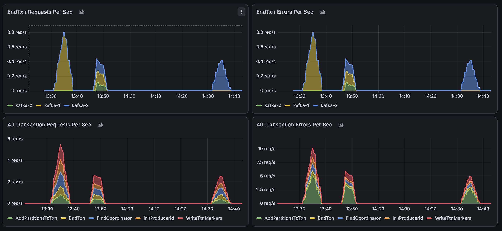

# Kafka Transactions Testing and Observability

## Monitoring Setup
Set up the Prometheus/Grafana stack from `../monitoring/prometheus-grafana/`, then we add the following Transaction Dashboard:
```shell
./deploy_dashboard.sh

# OR

kubectl create configmap "grafana-kafka-txn" -n "monitoring" --from-file="DashboardTxn.json" --dry-run=client -o yaml \
    | kubectl apply --server-side --force-conflicts -f -
kubectl label configmap "grafana-kafka-txn" -n "monitoring" grafana_dashboard=1 --overwrite
```

## Logging configuration
We need to set relevant loggers to `DEBUG` level so we can capture more details of the transactions:
```shell
./set_txn_debug_loggers.sh

# OR run for each broker ID

kubectl -n confluent exec -it kafka-0 -- \
  kafka-configs --bootstrap-server localhost:9092 \
  --alter --entity-type broker-loggers --entity-name <broker-id> \
  --add-config "kafka.coordinator.transaction.TransactionCoordinator=DEBUG,kafka.coordinator.transaction.TransactionStateManager=DEBUG,kafka.server.KafkaApis=DEBUG,kafka.request.logger=INFO,kafka.coordinator.group.GroupCoordinator=DEBUG"
```

## Client Example
Create some random transactional data with `kcat` (pod required):
```shell
kubectl exec kcat -it -- bash -c "cat /dev/urandom | \
  tr -dc 'a-zA-Z0-9' | fold -w 128 | head -n 50 | \
  kcat -b kafka.source:9092 -t test-topic -P -X transactional.id=TestProducerApp"
```
We can create 100 transactions with 500 messages each. Using 1s sleep to wait for transactions to be committed:
```shell
kubectl exec kcat -- bash -c '
for i in $(seq 1 100); do
  cat /dev/urandom | tr -dc "a-zA-Z0-9" | fold -w 128 | head -n 500 | \
    kcat -b kafka.source:9092 -t test-topic -P -X transactional.id=testproducerapp1
  sleep 1
done
'
```

## Log and Dashboard Results
In your logs you will observe transaction details similar to this:
```log
1786713152988	2026-08-14T13:12:32.988Z	[DEBUG] 2026-08-14 13:12:32,988 [data-plane-kafka-request-handler-4] kafka.coordinator.transaction.TransactionStateManager debug - [Transaction State Manager 2]: Updating testproducerapp1's transaction state to TxnTransitMetadata(producerId=1000, lastProducerId=1000, producerEpoch=200, lastProducerEpoch=-1, txnTimeoutMs=60000, txnState=CompleteCommit, topicPartitions=Set(), txnStartTimestamp=1786713152830, txnLastUpdateTimestamp=1786713152864) with coordinator epoch 0 for testproducerapp1 succeeded

1786713152862	2026-08-14T13:12:32.862Z	[DEBUG] 2026-08-14 13:12:32,862 [data-plane-kafka-request-handler-2] kafka.coordinator.transaction.TransactionStateManager debug - [Transaction State Manager 2]: Updating testproducerapp1's transaction state to TxnTransitMetadata(producerId=1000, lastProducerId=1000, producerEpoch=200, lastProducerEpoch=-1, txnTimeoutMs=60000, txnState=PrepareCommit, topicPartitions=Set(test-topic-0), txnStartTimestamp=1786713152830, txnLastUpdateTimestamp=1786713152861) with coordinator epoch 0 for testproducerapp1 succeeded

1786713152859	2026-08-14T13:12:32.859Z	[DEBUG] 2026-08-14 13:12:32,859 [data-plane-kafka-request-handler-4] kafka.coordinator.transaction.TransactionCoordinator debug - [TransactionCoordinator id=2] Prepare COMMIT of transaction due to client EndTxn request: TransactionMetadata(transactionalId=testproducerapp1, producerId1000, producerEpoch=200, txnTimeoutMs=60000, state=Ongoing, pendingState=None, txnStartTimestamp=1786713152830, txnLastUpdateTimestamp=1786713152830, numPartitions=1, includesOffsets=false)

1786713152831	2026-08-14T13:12:32.831Z	[DEBUG] 2026-08-14 13:12:32,831 [data-plane-kafka-request-handler-2] kafka.coordinator.transaction.TransactionStateManager debug - [Transaction State Manager 2]: Updating testproducerapp1's transaction state to TxnTransitMetadata(producerId=1000, lastProducerId=1000, producerEpoch=200, lastProducerEpoch=-1, txnTimeoutMs=60000, txnState=Ongoing, topicPartitions=Set(test-topic-0), txnStartTimestamp=1786713152830, txnLastUpdateTimestamp=1786713152830) with coordinator epoch 0 for testproducerapp1 succeeded

1786713152825	2026-08-14T13:12:32.825Z	[INFO] 2026-08-14 13:12:32,824 [data-plane-kafka-request-handler-3] kafka.coordinator.transaction.TransactionCoordinator info - [TransactionCoordinator id=2] Initialized transactionalId testproducerapp1 with producerId 1000 and producer epoch 200 on partition __transaction_state-34
```

Example Dashboard view of 100s of transactions commited at the same time for the same transaction IDs:

